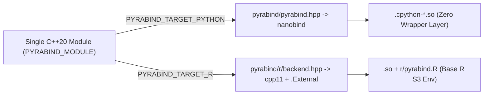

# Architecture: `pyrabind`

`pyrabind` provides a single C++20 `nanobind`-compatible binding API (`PYRABIND_MODULE`, `nb::class_`, `nb::enum_`, `nb::ndarray`, `nb::data_frame`) that compiles natively into both a **Python 3 extension** (via upstream `nanobind`) and an **R 4 shared library** (via `cpp11` and base R C routines) from one source file with zero target conditionals.

---

## 1. Zero-Overhead Python Backend (`nanobind`)

When `PYRABIND_TARGET_PYTHON` is active:

- `include/pyrabind/pyrabind.hpp` includes upstream `<nanobind/nanobind.h>` directly and re-exports `namespace pyrabind { using namespace ::nanobind; }` and `#define PYRABIND_MODULE(name, variable) NB_MODULE(name, var)` (plus `#define PYRABIND_MAKE_OPAQUE(...) NB_MAKE_OPAQUE(__VA_ARGS__)`).
- `operators.hpp`, `make_iterator.hpp`, `ndarray.hpp`, and `stl/*.hpp` forward straight to upstream `<nanobind/*.h>`.
- **Zero wrapper layer**: There are no adapter objects, extra type tables, heap-allocated argument vectors, or extra C calls around `nanobind`. Compiled binaries and call latency are identical to hand-written `nanobind`.
- `include/pyrabind/python/dataframe.hpp` provides a native `nanobind::detail::type_caster<pyrabind::data_frame>` supporting nullable `pandas.DataFrame` tables (including NumPy buffers, nullable masked arrays, and `pandas` 3.x `'O'` string columns) as well as plain `dict` fallbacks when `numpy` or `pandas` are absent.
- `pyrabind/eigen.hpp` and `pyrabind/arrow.hpp` forward Eigen dense/`Map`/`Ref` types straight to `<nanobind/eigen/dense.h>` and bridge `pyrabind::arrow_batch` through the Arrow PyCapsule Protocol (`__arrow_c_array__`).

---

## 2. High-Performance R Backend (`cpp11` + `.External` + Hashed Environments)

When `PYRABIND_TARGET_R` is active:

- `include/pyrabind/r/backend.hpp` implements matching `module_`, `class_<T, Bases...>`, `enum_<E>`, `exception<T>`, `handle`, `type<T>()`, `init<>`, `new_`, `overload_cast`, `kw_only`, `call_guard`, `gil_scoped_release`/`_acquire`, `rv_policy`, `keep_alive<Nurse, Patient>`, `capsule`, static property descriptors (`def_*_static`), and typed exception factories (`value_error`, `type_error`, `index_error`, `key_error`, `attribute_error`, `stop_iteration`).
- **`cpp11` Safety Integration** (`src/r/`):
  - R headers are always included through `<cpp11/R.hpp>` (`R_NO_REMAP` and `STRICT_R_HEADERS`).
  - Fallible allocating or evaluating R API calls run inside `cpp11::unwind_protect` / `cpp11::safe[...]` so R `longjmp` unwinds C++ stack frames cleanly.
  - `r_error_boundary` catches every C++ exception, runs registered `r_register_exception_translator` handlers for custom `nb::exception<T>` hierarchies first, and falls back to structured R S3 conditions (`pyrabind_value_error`, `pyrabind_type_error`, `pyrabind_index_error`, `pyrabind_key_error`, `pyrabind_attribute_error`, `pyrabind_stop_iteration`, `pyrabind_runtime_error`) catchable via `tryCatch()`.
- **Low-Overhead `.External` Dispatch & Stack-Allocated Arguments**:
  - Free functions, constructors, and bound methods use R `.External` routines (`pyrabind_ext_call_fn`, `pyrabind_ext_construct`, `pyrabind_ext_call_method`) registered via `R_registerRoutines` with `R_useDynamicSymbols(dll, FALSE)` inside `R_init_<module>`.
  - Unlike `.Call` wrappers that allocate `list(...)` and `names(args)` on every invocation, `.External` passes R's raw `LISTSXP` call pairlist straight into C++.
  - `call_args` decodes up to 16 positional and keyword arguments onto inline stack arrays (`inline_pos[16]`, `inline_kw_names[16]`, `inline_kw_vals[16]`), allocating on the heap only when more than 16 arguments are passed; `resolve_arguments` enforces `max_positional` for `nb::kw_only()`.
- **Pre-Built Per-Class R Environments & S3 Dispatch (`r/pyrabind.R`)**:
  - At module load time (`pyrabind_load`), each C++ class receives a cached `cls_meta` environment containing hashed `methods` and `props` sub-environments chained via `parent.env` to mirror C++ single inheritance, while `pyrabind_class` carries `.pb_statics` and `.pb_static_props` environments for static methods and static properties.
  - Member lookup (`x$method(...)`, `x$prop`) resolves via a single C `get0(..., inherits = TRUE)` call in base R and passes the resolved method/property external pointer directly to `.External` or `.Call` — eliminating C++ string lookup round-trips on property and method invocations.
  - S3 methods cover `Ops.pyrabind_object` (including binary `+`, `-`, `*`, `/`, `%%`, `&`, `|`, comparisons, unary `-`, `+`, and negated `__bool__` for `!`), `abs.pyrabind_object`, and `pyrabind_iterator` (`$__next__()`, `$__iter__()`, `as.list()`, `print()`).
- **Ownership Relinquishment, Lifetimes & Zero-Copy Data**:
  - `owned_instance_ctrl` and `r_relinquish_unique_ptr` enable safe `std::unique_ptr<T>` ownership transfer out of R external pointers, invalidating moved-from handles so subsequent accesses fail deterministically rather than dangling.
  - `rv_policy::reference_internal`, `automatic_reference`, and `nb::keep_alive<Nurse, Patient>` chain `patient` SEXP references onto `R_ExternalPtrProtected(nurse)` so the R garbage collector keeps linked objects alive as long as the nurse handle exists.
  - R vectors (`REALSXP`, `INTSXP`, `RAWSXP`) and matrices/arrays (`R_DimSymbol`) wrap directly without copying using R column-major strides (`stride(0) = 1`, `stride(1) = nrow`), while owning `nb::ndarray` outputs materialize native column-major R vectors/matrices and release the C++ `capsule`.
  - `pyrabind/r/eigen.hpp` maps R matrices and vectors cleanly into `Eigen::Matrix`, `Eigen::Array`, `Eigen::Map`, and `Eigen::Ref` (`DRef`/`DMap`/`DStride`/`DRef1`/`DMap1`) with `ALTREP` protection on mutable refs, while `pyrabind/arrow.hpp` converts `arrow_batch` to/from R `nanoarrow_array` external pointers storing their `nanoarrow_schema` on `R_ExternalPtrTag`.
- **Installable R Packages & Stress Verification**:
  - `pyrabind_load(path)` in `r/pyrabind.R` accepts both shared-library paths (`character`) and `DLLInfo` objects returned by `library.dynam(...)` inside package `.onLoad`, enabling standalone `R CMD INSTALL` packages (demonstrated in `examples/pyra_stats/rpkg`).
  - Correctness is hardened by `tests/r/test_gctorture.R` (`gctorture(TRUE)` stress testing external pointer finalizers, `keep_alive`, and GC pressure) alongside the `asan-ubsan` sanitizer CMake preset.
